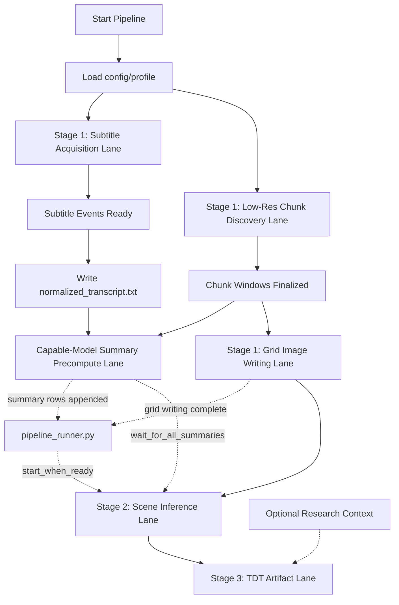

# Architecture

## Overview

The project operates as a config-driven pipeline driven by `pipeline_runner.py`, executing in overlapping lanes. It is configured by a single `config/pipeline.toml` that defines alias-based model roles, stage defaults, and execution profiles.

### Mermaid Runtime Diagram

### Flow of Execution

1. **Config and Profile Load:** `pipeline_runner.py` reads `config/pipeline.toml`, resolving provider endpoints and model aliases for `subtitle_summary_model`, `scene_analysis_model`, and `artifact_model`.
2. **Subtitle Acquisition & Chunk Discovery:** `extractor_v1.py` runs subtitle export or `subliminal` fallback in parallel with low-resolution video analysis and adaptive chunk discovery.
3. **Normalized Transcript Export:** Once subtitle events are known, the extractor writes `subtitles/normalized_transcript.txt`. The format is one chronological line per subtitle event: `START_SECOND | text`.
4. **Summary Precompute:** `subtitle_summary_precompute.py` sends the same full normalized transcript on every summary request so providers can reuse token-cached prefixes. Only the cutoff second and target chunk vary across requests. Older subtitle history is summarized; the last three scene windows stay available as raw tail context.
5. **Grid Image Writing:** The extractor writes the final 2x2 grid JPEGs and appends `manifest.jsonl` rows.
6. **Summary Gating:** When `execution.summary_gate = "start_when_ready"`, `pipeline_runner.py` starts scene inference after grid writing is complete while the extractor continues appending summary rows. When `summary_gate = "wait_for_all_summaries"`, inference waits until subtitle precompute finishes.
7. **Scene Inference:** `inference_runner.py` uses `image_with_precomputed_subtitle_context` by default. It polls the summary cache for each grid, then combines the capable-model summary, recent raw subtitles, and the grid image in one prompt.
8. **Artifact Generation:** `artifact_runner.py` authors the final Timed Descriptive Transcript, validates it, retries on schema errors, and can optionally enrich the prompt with `asky` research context.

## Stage 1 Outputs

Each extractor run lives in its own `output/run_<preset>_<timestamp>/` directory.

- `manifest.jsonl`: Ordered grid metadata used by downstream inference.
- `diagnostics.json`: Thresholds, timings, and run-level metrics.
- `grids/scene*.jpg`: Timestamped 2x2 grid images.
- `subtitles/`: Extracted text subtitle streams, `catalog.json`, and `normalized_transcript.txt`.
- `contexts/subtitle_summaries.jsonl`: Capable-model precomputed summaries.

## Stage 2 Components

- `subtitle_ingestion.py`: Resolves subtitle input and exports the normalized transcript format used by summary precompute.
- `context_strategies.py`: Converts grid records and precomputed summaries (or legacy strategies) into prompt context.
- `subtitle_summary_precompute.py`: Orchestrates asynchronous summary generation during extraction and appends summary-cache rows incrementally.
- `scene_memory.py`: Holds deterministic legacy bounded subtitle memory helpers.
- `pipeline_config.py`: Unified TOML configuration loader and alias resolver.
- `openai_compatible_client.py`: Sends JSON-repaired chat completions.
- `pipeline_runner.py` / `inference_runner.py`: Orchestrate the runtime graph, summary gating, and sequential inference requests.
- `tdt_format.py` / `artifact_runner.py`: Schema definitions and the final artifact authoring stage.
- `research_context.py`: Optional lazy `asky` integration.

## Testing Approach

The regression surface is protected with small `unittest` modules that focus on:
- pipeline config and alias resolution
- cache-friendly subtitle summary precompute and pipeline orchestration
- subtitle parsing and strategies
- artifact validation and retries
